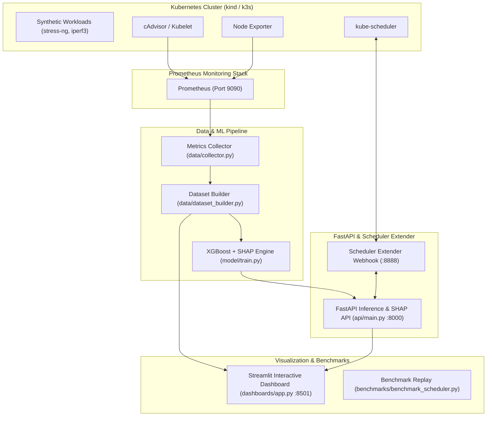

# SHAP-CC: Explainable AI Kubernetes Scheduler & Energy Optimizer

**SHAP-CC** (Shera-Real) is an end-to-end explainable AI scheduling system for Kubernetes. It optimizes workload placement across cluster nodes to minimize energy consumption and mitigate resource contention while providing full transparency into every scheduling decision using **SHAP (SHapley Additive exPlanations)**.

The project is structured in two cost-effective phases:
- **Phase 1 (Free / Local)**: Developed and verified locally on Windows/Linux using Docker, kind (3-node cluster: 1 control-plane, 2 workers), and the `kube-prometheus-stack`.
- **Phase 2 (AWS Deployment)**: Low-cost cloud deployment using **k3s on EC2** (~$3–4/day) rather than AWS EKS ($70+/month for control plane alone), with energy proxy modeling.

---

## 🏗️ Architecture Overview



---

## 📂 Repository Structure

```text
shap-cc/
├── infra/                  # Cluster infrastructure & deployment scripts
│   ├── kind-config.yaml    # Local kind cluster (1 control-plane, 2 workers)
│   ├── setup-kind.ps1      # Kind cluster bootstrap script (PowerShell)
│   ├── setup-monitoring.ps1# Prometheus & Grafana Helm installer
│   └── aws-k3s-notes.md    # Phase 2 AWS deployment and cost-control guide
├── workloads/              # Synthetic stress workloads & generator
│   ├── Dockerfile          # Image with stress-ng, iperf3
│   ├── generator.py        # Automated batch workload runner
│   ├── cpu-job.yaml        # CPU stress job template
│   ├── memory-job.yaml     # Memory stress job template
│   └── iperf-server.yaml   # Network iperf3 server deployment & service
├── data/                   # Metrics extraction and datasets
│   ├── collector.py        # Queries Prometheus HTTP API for pod & node metrics
│   ├── dataset_builder.py  # Generates 5,000+ sample ML training dataset
│   ├── prometheus_metrics_timeseries.csv # Raw scraped time series
│   ├── workloads_observed_summary.csv    # Empirical summary of cluster runs
│   └── workload_features_dataset.csv     # Featurized ML dataset
├── model/                  # Training and SHAP explainability
│   ├── train.py            # Trains XGBoost regressors and fits TreeExplainer
│   ├── placement_model.joblib # Trained node placement scoring model
│   ├── energy_model.joblib # Predicted energy impact model (Joules)
│   ├── contention_model.joblib # Contention & throttling risk model
│   ├── explainer.joblib    # SHAP TreeExplainer artifact
│   ├── shap_summary.png    # Beeswarm summary plot
│   └── feature_importance.png # Global feature importance chart
├── api/                    # Production FastAPI microservice
│   └── main.py             # Endpoints: /predict/score, /explain, /scheduler/prioritize
├── scheduler/              # Kubernetes Scheduler Extender
│   ├── extender.py         # Extender webhook listening on :8888
│   ├── scheduler-extender-config.yaml # KubeSchedulerConfiguration for kind/k3s
│   ├── deployment.yaml     # Kubernetes manifest to run extender in cluster
│   └── sample-pod.yaml     # Sample workload to test intelligent scheduling
├── dashboards/             # Interactive web visualization
│   └── app.py              # Streamlit dashboard
├── benchmarks/             # Evaluation against Default K8s Scheduler
│   ├── benchmark_scheduler.py # Replay simulation across 100 workloads
│   ├── benchmark_results.json # JSON benchmark output
│   └── scheduler_comparison.png # Comparison visual
├── tests/                  # Pytest automated test suite
│   └── test_shap_cc.py     # Unit and integration tests (100% pass)
└── README.md
```

---

## 🚀 Quick Start Guide (Phase 1: Local Laptop)

### 1. Prerequisites
- **Docker Desktop**
- **kind** (`kind create cluster`)
- **kubectl** & **Helm**
- **Python 3.11+** with dependencies:
  ```bash
  pip install fastapi uvicorn requests pandas numpy scikit-learn xgboost shap streamlit matplotlib joblib pytest
  ```

---

### 2. Verify or Start Local Cluster & Monitoring

If not already running:
```powershell
# Create kind cluster
kind create cluster --config infra/kind-config.yaml

# Install monitoring stack
helm repo add prometheus-community https://prometheus-community.github.io/helm-charts
helm install monitoring prometheus-community/kube-prometheus-stack --namespace monitoring --create-namespace

# Forward Prometheus to localhost:9090
kubectl port-forward -n monitoring svc/monitoring-kube-prometheus-prometheus 9090:9090
```

---

### 3. Generate Workloads on Kubernetes
Run automated waves of CPU, memory, network, and mixed stress jobs:
```powershell
# Runs 2 batches of 4 jobs across kind-worker and kind-worker2
python workloads/generator.py --batches 2 --batch-size 4
```

---

### 4. Extract Prometheus Metrics & Build Large Dataset
Query Prometheus for real CPU rate, memory working set, network RX/TX, throttling, and node loads:
```powershell
# 1. Pull raw Prometheus time-series and compute per-job summary
python data/collector.py --hours 3.0

# 2. Build expanded 5,000-sample training dataset calibrated to empirical runs
python data/dataset_builder.py --samples 5000
```

---

### 5. Train Model & Compute SHAP Values
Train XGBoost models for placement scoring, energy proxy, and contention risk, and fit the SHAP TreeExplainer:
```powershell
python model/train.py
```
*Outputs:*
- Placement Model $R^2$: `0.989`
- Energy Model $R^2$: `0.991`
- Generates `model/shap_summary.png` and `model/feature_importance.png`

---

### 6. Start the FastAPI SHAP Service
Launch the inference and explanation service:
```powershell
python -m uvicorn api.main:app --host 0.0.0.0 --port 8000 --reload
```
- Interactive Swagger API Docs: [http://localhost:8000/docs](http://localhost:8000/docs)
- Health check: `curl http://localhost:8000/health`

---

### 7. Run the Kubernetes Scheduler Extender
Start the scheduler extender webhook:
```powershell
python scheduler/extender.py
```
The extender listens on port 8888, intercepts pod scheduling requests, queries Prometheus for candidate node metrics, and assigns scores based on SHAP energy/contention minimization.

---

### 8. Launch the Interactive Dashboard
Launch the Streamlit dashboard to explore live cluster metrics, dataset distributions, and interactive SHAP waterfalls:
```powershell
streamlit run dashboards/app.py
```
Open [http://localhost:8501](http://localhost:8501) in your browser.

---

### 9. Run Benchmarks & Tests
Compare Default Kubernetes Scheduler vs SHAP-CC Scheduler across 100 workloads:
```powershell
# Run benchmark
python benchmarks/benchmark_scheduler.py

# Run test suite
python -m pytest tests/
```

---

## ☁️ Phase 2: AWS Deployment (k3s on EC2)

For complete cloud deployment instructions and cost controls, refer to [`infra/aws-k3s-notes.md`](file:///c:/Users/mugil/OneDrive/Documents/shap-cc/infra/aws-k3s-notes.md).

### Summary of AWS Guidelines:
1. **Never use AWS EKS** for academic/prototype workloads: it incurs a flat $0.10/hour fee for the control plane.
2. Launch 3 EC2 instances in a single VPC:
   - 1x `t3.medium` (k3s server + Prometheus)
   - 2x `t3.small` / `t3.medium` (k3s worker agents)
3. **Power Measurement Reality**: EC2 virtual machines isolate bare-metal MSRs (RAPL). Use the validated **CPU-seconds dynamic power proxy model** explicitly in your evaluation.
