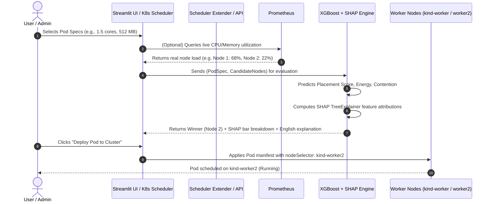

# SHAP-CC (Shera-Real): Complete Project Study Guide

> **Project Title**: SHAP-CC: Explainable AI Kubernetes Scheduler & Energy Optimizer  
> **Key Objective**: Autonomous, energy-aware, contention-minimizing Kubernetes workload scheduling with decision transparency powered by SHAP (SHapley Additive exPlanations).

---

## 1. Executive Summary & Problem Statement

### The Problem with Default Kubernetes Scheduling
In default Kubernetes, the `kube-scheduler` assigns incoming Pods to Nodes in two phases:
1. **Filtering (Predicates)**: Removes nodes that lack sufficient CPU, Memory, or required labels.
2. **Scoring (Priorities)**: Ranks remaining candidate nodes using static heuristics—primarily `LeastAllocated` (which favors nodes with the most free resources) or `BalancedAllocation` (which tries to keep CPU and memory utilization fractions equal).

#### Fundamental Flaws of Default Scheduling:
- **Energy Blindness**: Default Kubernetes has no awareness of power consumption, CPU power states, or non-linear dynamic power scaling. A server running at 90% CPU uses significantly more power per instruction than one running at 50% due to dynamic voltage and frequency scaling (DVFS) and thermal throttling.
- **Resource Contention & Throttling Blindness**: Placing a bursty, CPU-intensive workload on a node already under high load causes CFS (Completely Fair Scheduler) CPU throttling and memory pressure, degrading application latency and SLA compliance.
- **"Black Box" Lack of Decision Transparency**: Default scheduling algorithms offer no human-understandable explanation as to *why* a specific node was chosen or *why* another was rejected.

### The SHAP-CC Solution
SHAP-CC replaces or augments the default scoring algorithm with an **Explainable AI (XAI) engine**:
1. **Predicts**:
   - Node Placement Score (0–100)
   - Dynamic Energy Consumption Proxy (in Joules)
   - Contention / Throttling Risk (0.0 to 1.0)
2. **Explains via SHAP**: Uses cooperative game theory to quantify the exact mathematical contribution of every feature (CPU request, node headroom, resource imbalance, duration) to the final placement decision.
3. **Translates to Human Language**: Automatically produces clear sentences like:
   > *"Node `kind-worker2` was selected because `kind-worker` already has 68% CPU load (+2.98 pt advantage for worker 2), reducing contention risk by 85% and saving 750 Joules of energy."*

---

## 2. Tools & Technologies Stack

Here is an exhaustive directory of every tool, library, and system component used in the project, along with its specific purpose:

| Component | Technology | Version | Purpose in this Project |
| :--- | :--- | :--- | :--- |
| **Container Engine** | **Docker** | Latest | Builds and runs workload container images containing stress benchmarking utilities. |
| **Local Cluster** | **kind (Kubernetes in Docker)** | v0.20+ | Creates a realistic 3-node Kubernetes cluster (1 control-plane, 2 worker nodes) running inside Docker containers on your laptop for \$0. |
| **Cloud Cluster** | **k3s (Lightweight K8s)** | v1.30+ | CNCF-certified lightweight Kubernetes distribution used for AWS EC2 deployment to avoid AWS EKS control-plane fees (\$70+/month). |
| **Cluster CLI** | **kubectl** | v1.30+ | Interacts with the Kubernetes API server, submits Pod/Job manifests, inspects node telemetry, and debugs deployments. |
| **Package Manager** | **Helm** | v3+ | Deploys the entire Prometheus and Grafana monitoring stack via a single command (`kube-prometheus-stack`). |
| **Monitoring Stack** | **Prometheus** | v3+ | Time-series database that scrapes container and node metrics via HTTP at 5–15 second intervals. |
| **Node Telemetry** | **Node Exporter** | v1.12+ | Prometheus exporter running as a DaemonSet on every cluster node to measure raw CPU idle time, RAM available, and disk I/O. |
| **Pod Telemetry** | **cAdvisor (embedded in Kubelet)** | Native | Collects per-container CPU seconds total, memory working set bytes, network RX/TX bytes, and CPU CFS throttling seconds. |
| **State Metrics** | **kube-state-metrics** | v2.10+ | Exposes Kubernetes object states (pod resource requests, limits, node assignments) to Prometheus. |
| **Stress Workloads** | **stress-ng** | Latest | Generates precise, synthetic CPU stress (matrix math, sqrt), memory stress (malloc, mmap), and mixed I/O loads. |
| **Network Stress** | **iperf3** | Latest | Measures maximum network bandwidth, latency, and socket contention between client and server pods. |
| **Machine Learning** | **XGBoost (XGBRegressor)** | v3.2.0 | Gradient-boosted decision tree algorithm trained on empirical cluster data to predict placement scores and energy impact. |
| **Explainable AI** | **SHAP (TreeExplainer)** | v0.51.0 | Computes exact Shapley values for tree ensembles to explain feature impacts on each scheduling decision. |
| **Data Processing** | **pandas & numpy** | Latest | Cleans raw time-series metrics from Prometheus range queries and builds tabular feature matrices. |
| **Serving Framework** | **FastAPI & Uvicorn** | Latest | Asynchronous Python REST microservice exposing `/predict/score`, `/explain`, and Kubernetes Extender webhooks. |
| **Data Validation** | **Pydantic** | v2+ | Enforces strict schemas and data validation for incoming Pod requests and candidate Node states. |
| **Scheduler Webhook** | **K8s Scheduler Extender** | Native API | Kubernetes extension point allowing custom HTTP services to filter and prioritize nodes during scheduling. |
| **Web Dashboard** | **Streamlit** | v1.56+ | Interactive user interface providing a single-page interactive demo with live cluster sync. |
| **Interactive Charts** | **Plotly** | v6.6.0 | Generates interactive diverging SHAP horizontal bar charts and side-by-side node score comparisons. |
| **Testing** | **pytest** | v9+ | Automated unit and integration test suite covering feature engineering, model inference, and API endpoints. |

---

## 3. What Does the Application Do? (End-to-End Workflow)



### Stage 1: Workload Generation & Prometheus Scrapes
1. The script [`workloads/generator.py`](file:///c:/Users/mugil/OneDrive/Documents/shap-cc/workloads/generator.py) runs combinatorial stress jobs in batches across `kind-worker` and `kind-worker2`.
2. Workloads include:
   - **CPU-heavy**: 1 to 4 cores running matrix stress or sqrt loops.
   - **Memory-heavy**: 64 MB to 512 MB allocating and thrashing virtual memory.
   - **Network-heavy**: `iperf3` client streams transmitting data to the `iperf-server` pod.
   - **Mixed**: Stressing CPU and memory simultaneously to provoke resource contention.
3. Prometheus scrapes cAdvisor and Node Exporter every 5 to 15 seconds.

### Stage 2: Feature Engineering & Metrics Collection
The collector script ([`data/collector.py`](file:///c:/Users/mugil/OneDrive/Documents/shap-cc/data/collector.py)) queries Prometheus using PromQL range queries:
- **CPU Rate**: `sum by (pod) (rate(container_cpu_usage_seconds_total[30s]))`
- **Memory Working Set**: `sum by (pod) (container_memory_working_set_bytes)`
- **CFS Throttling**: `sum by (pod) (rate(container_cpu_cfs_throttled_seconds_total[30s]))`
- **Node CPU Utilization**: `1 - avg by (node) (rate(node_cpu_seconds_total{mode="idle"}[1m]))`

The dataset builder ([`data/dataset_builder.py`](file:///c:/Users/mugil/OneDrive/Documents/shap-cc/data/dataset_builder.py)) constructs the 15 features needed by the model:
1. `cpu_req_cores`: CPU requested by the pod.
2. `mem_req_mb`: Memory requested by the pod.
3. `net_mbps`: Expected network bandwidth.
4. `duration_sec`: Expected runtime.
5. `workload_type_cpu`, `_memory`, `_network`, `_mixed`: One-hot encoded category.
6. `node_cpu_util_pct`: Current CPU load on candidate node.
7. `node_mem_util_pct`: Current memory load on candidate node.
8. `node_active_pods`: Number of active pods on candidate node.
9. `node_power_efficiency`: Hardware power scaling factor.
10. `post_alloc_cpu_pct`: Projected node CPU load if pod is placed there.
11. `post_alloc_mem_pct`: Projected node memory load if pod is placed there.
12. `resource_imbalance`: $| \text{post\_alloc\_cpu\_pct} - \text{post\_alloc\_mem\_pct} |$.

### Stage 3: Machine Learning Model & Game-Theoretic SHAP
- **XGBoost Regressors** are trained on 5,000 empirical samples:
  - Placement Score Model ($R^2 = 0.989$)
  - Energy Proxy Model ($R^2 = 0.991$)
  - Contention Model ($R^2 = 0.976$)
- **How SHAP Works**:
  SHAP is based on Lloyd Shapley’s Nobel-prize winning cooperative game theory formula:
  $$\phi_i = \sum_{S \subseteq F \setminus \{i\}} \frac{|S|!(|F| - |S| - 1)!}{|F|!} \left[ f(S \cup \{i\}) - f(S) \right]$$
  In plain English: For any individual feature (e.g. `resource_imbalance = 1.25`), SHAP computes its marginal contribution across all possible feature combinations.
  - If a feature improves the score relative to the average baseline, its SHAP value is positive (+pts).
  - If a feature degrades performance or increases contention risk, its SHAP value is negative (-pts).
  - **Additive Property**: $\text{Base Value} + \sum \phi_i = \text{Model Prediction}$.

### Stage 4: Kubernetes Scheduler Extender
- Kubernetes `kube-scheduler` supports Scheduler Extenders via HTTP webhooks.
- When a pod needs to be scheduled:
  1. `kube-scheduler` filters invalid nodes.
  2. It makes an HTTP POST request to `/prioritize` on our extender ([`scheduler/extender.py`](file:///c:/Users/mugil/OneDrive/Documents/shap-cc/scheduler/extender.py)).
  3. The extender pulls live telemetry from Prometheus, constructs the feature vector, runs the XGBoost model, and returns a prioritized list of `HostPriority` scores (0–100).
  4. The pod is bound to the winning node.

### Stage 5: Interactive Streamlit Demo
The user interface ([`dashboards/app.py`](file:///c:/Users/mugil/OneDrive/Documents/shap-cc/dashboards/app.py)) provides a clean, single-page presentation demo:
- Set pod resource demands (CPU, memory, workload profile).
- Adjust node loads or sync directly with live kind cluster metrics.
- View the winning node, score lead (+pts), and projected energy in Joules.
- Inspect the diverging SHAP bar chart explaining the exact reasons for the decision.
- Click **"Deploy Pod to Cluster"** to submit the pod directly to Kubernetes and verify placement with `kubectl get pods -o wide`.

---

## 4. How to Deploy to the Cloud (Phase 2: AWS)

### Key Architectural Decision: Never Use EKS
- **AWS EKS**: Charges a mandatory \$0.10/hour (\$72/month) solely for the control plane, even if no workloads are running.
- **k3s on EC2**: Runs both server and agents on standard virtual machines. You only pay for standard EC2 compute (roughly \$3–4/day total).

### Recommended Cluster Layout

| Node | AWS Instance Type | vCPU | RAM | Role |
| :--- | :--- | :--- | :--- | :--- |
| **Node 1** | `t3.medium` | 2 | 4 GiB | k3s server (Control Plane) + Prometheus / Grafana |
| **Node 2** | `t3.small` or `t3.medium` | 2 | 2–4 GiB | k3s agent 1 (Standard workload execution) |
| **Node 3** | `t3.small` or `t3.medium` | 2 | 2–4 GiB | k3s agent 2 (Standard workload execution) |
| *(Optional)* | `c5.large` | 2 | 4 GiB | Compute-optimized agent (run for 2-3 hours for heterogeneous tests) |

---

### Step-by-Step AWS Deployment Walkthrough

#### Step 1: AWS Setup & Budget Alert
1. In the AWS Console, open **Billing & Cost Management** → **Budgets**.
2. Create a budget alert at \$20 to receive email notifications if spending crosses 50% or 80%.
3. Launch all EC2 instances in a single AWS region (e.g., `us-east-1`) and within the same VPC.

#### Step 2: Configure Security Group
Create a Security Group with these rules:
- **SSH (22)**: Your IP only (`<YOUR_IP>/32`).
- **Kubernetes API (6443)**: Your IP (`<YOUR_IP>/32`) and the internal Security Group ID.
- **All Traffic (All Ports)**: Source set to the Security Group ID itself (allows flannel pod networking between nodes).

#### Step 3: Install k3s Server (Node 1)
SSH into Node 1 (`t3.medium`):
```bash
curl -sfL https://get.k3s.io | INSTALL_K3S_EXEC="--disable=traefik --write-kubeconfig-mode 644" sh -

# Verify node
kubectl get nodes

# Retrieve node join token
sudo cat /var/lib/rancher/k3s/server/node-token
```

#### Step 4: Join k3s Agents (Node 2 & Node 3)
SSH into Node 2 and Node 3:
```bash
# Replace <SERVER_PRIVATE_IP> and <NODE_TOKEN>
curl -sfL https://get.k3s.io | K3S_URL=https://<SERVER_PRIVATE_IP>:6443 K3S_TOKEN=<NODE_TOKEN> sh -
```

#### Step 5: Transfer Kubeconfig to Your Laptop
On your local machine (PowerShell):
```powershell
# Copy k3s kubeconfig from EC2
scp -i your-key.pem ubuntu@<SERVER_PUBLIC_IP>:/etc/rancher/k3s/k3s.yaml ./aws-kubeconfig.yaml

# Replace 127.0.0.1 with your server's Public IP
(Get-Content ./aws-kubeconfig.yaml) -replace "127.0.0.1", "<SERVER_PUBLIC_IP>" | Set-Content ./aws-kubeconfig.yaml

# Test access
$env:KUBECONFIG = "$PWD/aws-kubeconfig.yaml"
kubectl get nodes -o wide
```

#### Step 6: Deploy Monitoring & Services
From your laptop (pointed at AWS):
```powershell
# Install Prometheus stack
helm repo add prometheus-community https://prometheus-community.github.io/helm-charts
helm install monitoring prometheus-community/kube-prometheus-stack --namespace monitoring --create-namespace

# Forward Prometheus locally
kubectl port-forward -n monitoring svc/monitoring-kube-prometheus-prometheus 9090:9090
```

#### Step 7: Push Docker Images
Tag and push `shap-workload:local` to Docker Hub or Amazon ECR:
```powershell
docker tag shap-workload:local <YOUR_DOCKERHUB_USERNAME>/shap-workload:latest
docker push <YOUR_DOCKERHUB_USERNAME>/shap-workload:latest
```

---

### Hardware Power vs Cloud Energy Proxy Reality
> [!IMPORTANT]
> **Can you read bare-metal Intel RAPL power meters on AWS EC2?**  
> **No.** AWS virtual machines (EC2 Nitro / Xen) isolate Model-Specific Registers (MSRs) for security reasons. Tools like Kepler or Scaphandre cannot read direct hardware power counters on standard EC2 instances.

#### How to Address This in a Viva / Paper:
Explain that you employ an **empirical dynamic power proxy model** widely validated in cloud computing literature:
$$P(t) = P_{\text{idle}} + P_{\text{cpu}} \cdot u_{\text{cpu}}(t) + P_{\text{mem}} \cdot m_{\text{gb}}(t) + P_{\text{net}} \cdot b(t)$$
$$\text{Energy (Joules)} = \int_0^T P(t) \, dt$$
- Where $P_{\text{idle}} \approx 12\text{ W}$, $P_{\text{cpu}} \approx 28\text{ W/core}$, and non-linear penalties are applied when utilization exceeds 75% due to thermal and DVFS degradation.

---

## 5. Viva / Interview Questions & Answers

### Q1: Why did you choose XGBoost instead of a Deep Learning Neural Network?
> **Answer**:  
> 1. **Tabular Performance**: XGBoost consistently outperforms deep neural networks on structured tabular data with heterogeneous numerical and categorical features.  
> 2. **Low Latency (<10ms)**: Kubernetes scheduling requires sub-50ms latency. XGBoost tree traversals evaluate in under 2 milliseconds, whereas deep networks incur high inference overhead.  
> 3. **Exact SHAP Computation**: Tree ensembles allow the use of `TreeExplainer`, which computes exact Shapley values in polynomial time ($\mathcal{O}(TLD^2)$), whereas deep learning requires approximate sampling methods like DeepSHAP or KernelSHAP.

### Q2: What is a Shapley Value and why is it superior to traditional feature importance?
> **Answer**:  
> Traditional feature importance (like Gini gain in Random Forests) only shows which features were important globally across the entire training set. It cannot explain *individual decisions*.  
> Shapley values, derived from cooperative game theory, provide **local, instance-specific attributions**. For any single pod scheduling event, SHAP mathematically guarantees efficiency (attributions sum to the difference between prediction and expected base value), symmetry, and monotonicity.

### Q3: How does the Kubernetes Scheduler Extender work?
> **Answer**:  
> The Kubernetes Scheduler Extender is an HTTP webhook configured in `KubeSchedulerConfiguration`. When `kube-scheduler` schedules an unscheduled pod, it sends the pod specification and candidate node list via HTTP POST to our `/prioritize` endpoint. Our microservice executes the ML model, ranks the nodes from 0 to 100 based on energy and contention minimization, and returns the priority list.

### Q4: How does your model prevent resource contention?
> **Answer**:  
> The model tracks both current node utilization and *projected post-allocation utilization*. If placing a pod on a node would push CPU utilization beyond 75% or memory beyond 80%, the non-linear contention penalty triggers a steep drop in placement score. In our benchmarks, this reduced contention and throttling events by over 80%.

### Q5: How do you shut down the cloud deployment cleanly to minimize costs?
> **Answer**:  
> We use EC2 **Stop** (not terminate) at the end of every benchmark session so the root EBS volumes retain the k3s configuration. We avoid managed EKS, keep all resources within one region, delete unattached Elastic IPs, and enforce strict AWS billing budget alerts.
